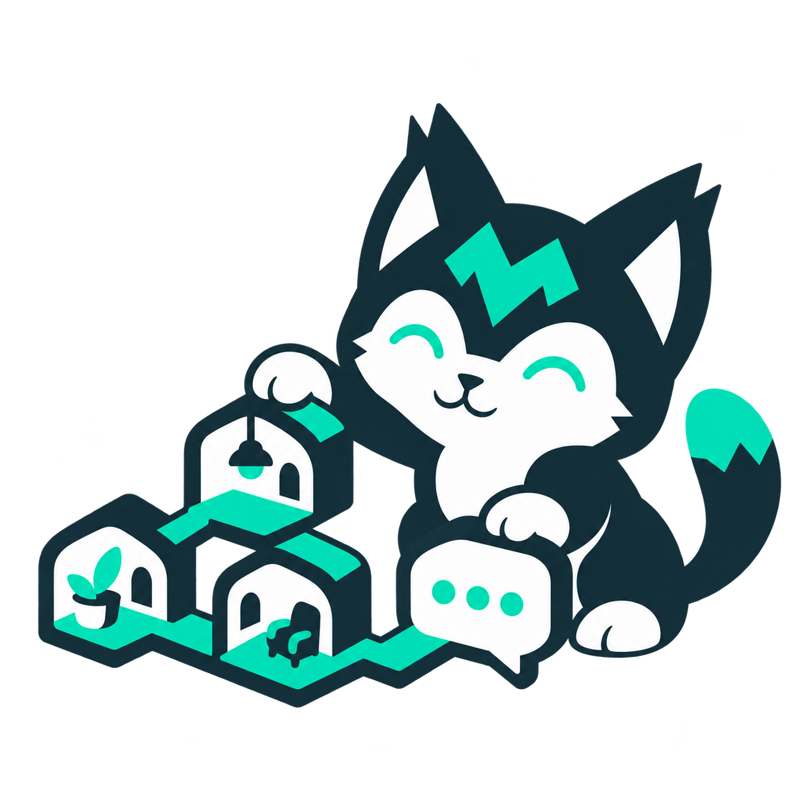

#  SharpMUSH

**Build and run your own multiplayer text world.**

SharpMUSH is an open-source MUSH server for collaborative stories, roleplay and world building. Create rooms and characters, write softcode, and manage your game through a browser-based portal. SharpMUSH targets PennMUSH compatibility so existing worlds have a path forward.

**[Try the live example](https://mush.sharpmush.com)** · **[Run a game](https://sharpmush.com/guides/docker-quickstart/)** · **[Read the docs](https://sharpmush.com)**

<p align="center">
  
</p>

## A world you can make your own

- **Build together.** Create interconnected rooms, characters and shared stories with familiar MUSH softcode.
- **Manage in a browser.** Use the web portal for characters, scenes, game information and administration.
- **Add capabilities.** Install [softcode packages](https://github.com/SharpMUSH/SharpMUSH.Packages), or extend the server with [C# plugins](https://sharpmush.com/guides/plugins/).
- **Bring an existing world.** Read the [PennMUSH migration guide](https://sharpmush.com/guides/pennmush-migration/) and [compatibility reference](https://sharpmush.com/reference/compatibility/) before moving your game.

## Join in

[Ask questions on Discord](https://discord.gg/jYErRbqaC9) · [Explore the package library](https://sharpmush.com/guides/package-library/) · [Develop SharpMUSH](https://sharpmush.com/guides/local-install/)

[](https://github.com/SharpMUSH/SharpMUSH/actions/workflows/dotnet.yml)
[](https://discord.gg/jYErRbqaC9)

## Release Status

Currently, there is no Release Candidate for SharpMUSH.
We are still in the early stages of development, and are working on getting a stable release out.

## Docker Deployment

SharpMUSH is available as Docker images on DockerHub:
- `sharpmush/sharpmush-server` - Main server
- `sharpmush/sharpmush-socketserver` - Stable telnet/WebSocket socket owner
- `sharpmush/sharpmush-connectionserver` - Replaceable rendering worker

For information on setting up automatic DockerHub publishing when new versions are released, see [DockerHub Setup Guide](./docs/DOCKERHUB_SETUP.md).

## Quick Contribution Guide

The full guide to running SharpMUSH from source and running its tests is [Develop SharpMUSH](https://sharpmush.com/guides/local-install/) on the documentation site.

### How to Build and Test

- Install [.NET 11](https://dotnet.microsoft.com/en-us/download/dotnet/11.0) — SDK 11.0.100-rc.2 or newer, as pinned in `global.json`
- Install [Docker Desktop](https://www.docker.com/products/docker-desktop/)

Build with:
```bash
dotnet build
```

Run the tests with:
```bash
dotnet test
```

> **Note:** Test telemetry output is disabled by default to reduce console noise. To enable telemetry metrics during test runs, set the environment variable:
> ```bash
> export SHARPMUSH_ENABLE_TEST_TELEMETRY=true
> dotnet test
> ```

The main entrypoint to set as a Startup Project is [`SharpMUSH.Server`](./SharpMUSH.Server).

For full integration, run [`SharpMUSH.SocketServer`](./SharpMUSH.SocketServer), which owns client sockets, and [`SharpMUSH.RenderingWorker`](./SharpMUSH.RenderingWorker), which renders output over a shared Unix socket. The local Compose stack wires all three processes and persistent NATS storage:

```bash
docker compose up --build
```

When launching projects separately on Linux, set `Rendering__SocketPath` to the same writable path (for example `/tmp/sharpmush-render.sock`) for both SocketServer and RenderingWorker, and provide `NATS_URL` to SocketServer and the main server. For quick images from Release binaries, use `Dockerfile.socketserver.local` for SocketServer and `Dockerfile.renderingworker.local` for the renderer; mount their shared socket directory.

See [connection updates and recovery](./deploy/connection-updates.md) for migration and restart behavior. The [development Kubernetes manifest](./kubernetes/dev-k8s.yaml) keeps SocketServer and renderer in one Pod: updating either image replaces that Pod and drops sockets. Use the single-host Compose deployment for independent renderer updates that retain client sockets.

Additionally, a Blazor web client is available at [`SharpMUSH.Client`](./SharpMUSH.Client).
