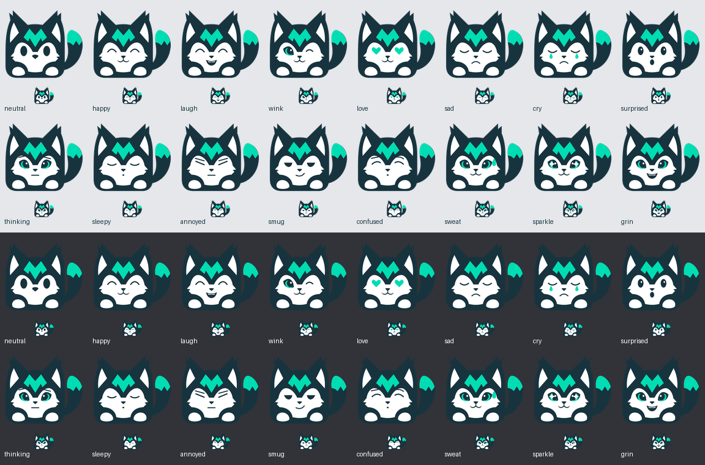

# Minimal Sharpie Discord emoji

Sixteen expressions using the approved minimal sitting mascot. The compact body, forehead M, upright tail, white paws and three-color palette stay fixed. Facial expressions adapt the primary emoji vocabulary to this simpler mascot. Neutral preserves the original minimal face.

Extract `sharpie-minimal-discord-emoji.zip` and upload the individual PNGs under Discord Server Settings → Emoji. Files use names such as `sharpie_min_happy`. These static transparent RGBA uploads are 128×128 and each is below 256 KiB. The visible silhouette fits a 126px long edge, with a one-pixel target safety margin and proportional space on the shorter axis.

`svg/` contains editable masters, `png-512/` larger renders and `png-128/` upload files. `manifest.json` records the source hash, framing, bounds and upload hashes. No server is changed automatically.

Rebuild with `python assets/branding/sharpie/discord-minimal/build_pack.py`. Requires Python 3, Pillow and Inkscape; the builder first refreshes the primary pack's shared expression vocabulary, then builds this family. Scratch uses repository `work/` on disk. The mascot identity masters remain unchanged.

[Primary pack and full expression list](../discord/README.md) · [Discord requirements](https://support.discord.com/hc/en-us/articles/360041139231-How-to-Add-Emojis-on-Discord)
