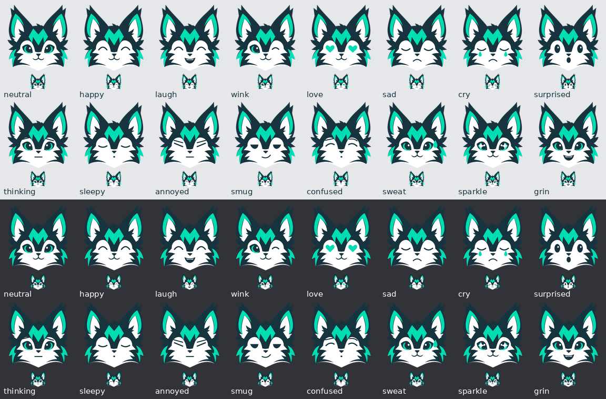

# Sharpie Discord emoji pack

Sixteen static expressions derived directly from the refined primary mascot. Shared ears, silhouette, forehead M, cheek accents and palette remain unchanged; facial details provide the expression.

## Install

Download `sharpie-discord-emoji.zip` and extract its 16 PNGs. In Discord, open Server Settings → Emoji → Upload Emoji with the server's emoji-management permission. Upload the individual files, not the ZIP. The filenames provide names such as `sharpie_happy`, used in chat as `:sharpie_happy:`. Nothing in this package uploads to or modifies a Discord server automatically.

Emoji derivatives fit the primary’s visible silhouette to a 126px long edge within the 128px canvas, leaving approximately one pixel of edge safety. The remaining space on the shorter axis follows the artwork’s proportions; no stretching or ear cropping is applied. This removes the identity master’s layout padding from the emoji files.

`png-128/` contains the transparent 128 × 128 upload files. Each is below 256 KiB. Discord commonly displays custom emoji at 32 × 32, so the preview includes that size. `png-512/` supplies larger renders; `svg/` supplies editable path masters. This is an emoji pack, not a Discord sticker pack. No Nitro-dependent animation is required.

Official requirements: [Discord custom emoji guide](https://support.discord.com/hc/en-us/articles/360041139231-How-to-Add-Emojis-on-Discord) and [Discord emoji API reference](https://github.com/discord/discord-api-docs/blob/main/developers/resources/emoji.mdx).

## Expressions

| Name | Expression |
|---|---|
| `sharpie_neutral` | Approved primary face |
| `sharpie_happy` | Closed smiling eyes |
| `sharpie_laugh` | Happy eyes and open grin |
| `sharpie_wink` | One closed eye |
| `sharpie_love` | Mint heart eyes |
| `sharpie_sad` | Downcast eyes and frown |
| `sharpie_cry` | Sad face with mint tears |
| `sharpie_surprised` | Wide eyes and O mouth |
| `sharpie_thinking` | Raised brows and flat mouth |
| `sharpie_sleepy` | Resting eyes and small mouth |
| `sharpie_annoyed` | Narrow eyes and angled brows |
| `sharpie_smug` | Half-lidded eyes and small smirk |
| `sharpie_confused` | Uneven brows and questioning face |
| `sharpie_sweat` | Primary face with mint sweat drop |
| `sharpie_sparkle` | Starry eye highlights |
| `sharpie_grin` | Open eyes and broad grin |

## Rebuild and verify

Run `python assets/branding/sharpie/discord/build_pack.py` from any directory. Requires Python 3, Pillow and Inkscape. Scratch stays in the repository's `work/sharpie-emoji/`; generated SVGs, PNGs, preview, ZIP and hash manifest are placed beside this file. The builder validates image dimensions, RGBA mode, transparent corners and file-size limits. `manifest.json` records the primary SVG hash and each upload hash. Palette remains ink `#17333E`, mint `#00DDB3` and white `#FFFFFF`.

These emoji are expression derivatives. They do not replace the static identity masters in `../approved/`.
