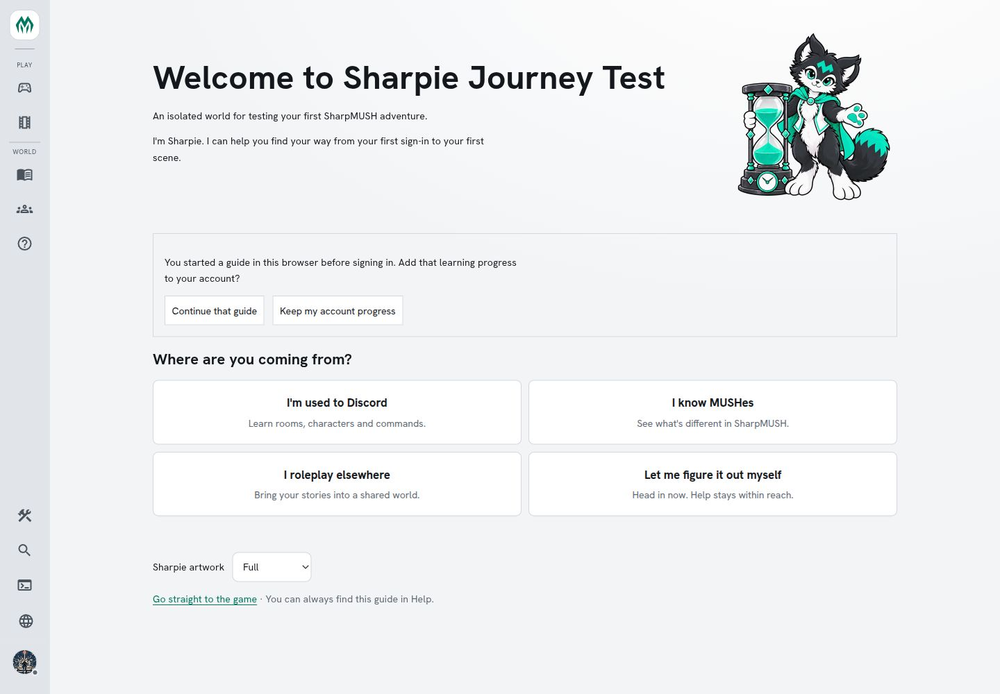
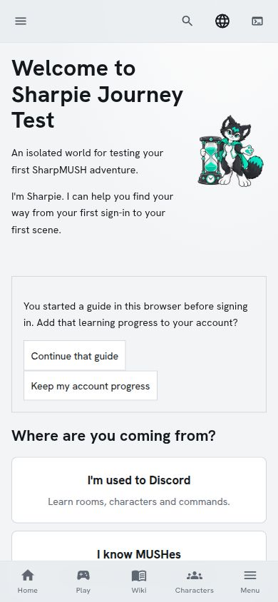
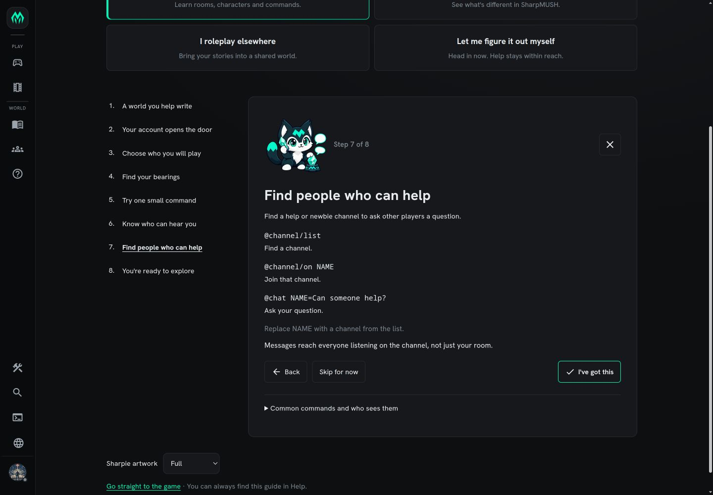
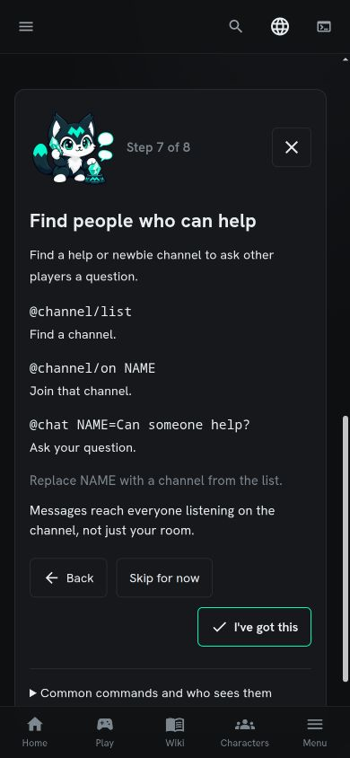
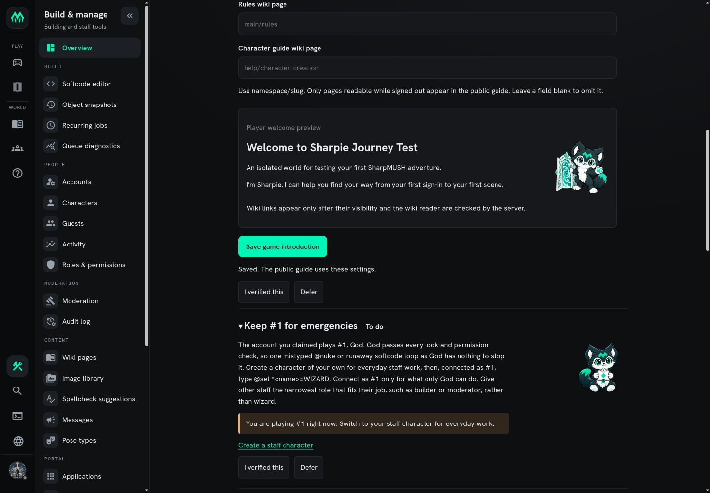

# Sharpie artwork runtime validation

Verified on 2026-11-04 in the isolated onboarding world using the actual published
Blazor client and matching server, with native browser interactions.

- Desktop: 1440 × 1000; mobile: 390 × 844 CSS pixels.
- Light (Daylight) and dark (Phosphor) themes: artwork loads with transparency,
  stays within its allocated area, and keeps ears, feet and props visible.
- Welcome, player lessons, the Play guide drawer and administrator welcome preview
  show contextual artwork. All six style choices update the administrator preview.
- Science Fiction / Time Travel and Fantasy / High Fantasy select subgenre artwork.
- Fantasy / None selects Fantasy artwork. The walkthrough exposed an incorrect
  precedence rule; a regression now checks 1,134 genre/style/topic combinations.
- The full component suite passed: 3,242 tests. Existing typed None/None selection,
  explicit overrides, reduced imagery and unavailable-art fallback tests also pass.

The local preview needed a normal client publish to resolve HTML fingerprint
placeholders, and a server built from the same checkout. An older server caused
checklist-save failures; saving succeeded after matching the binaries.

This verifies artwork integration and sampled responsive layouts, not a complete
accessibility audit or gameplay session. The isolated WebSocket gateway was not
running; command execution was not validated in this walkthrough. Full native
image QA and compression checks are separate from these page screenshots.

## Screenshots

Time Travel Kemono welcome, light desktop:

Time Travel Kemono welcome, light mobile:

Fantasy Chibi channel lesson, dark desktop and mobile:

High Fantasy Chibi administrator preview, dark desktop:

