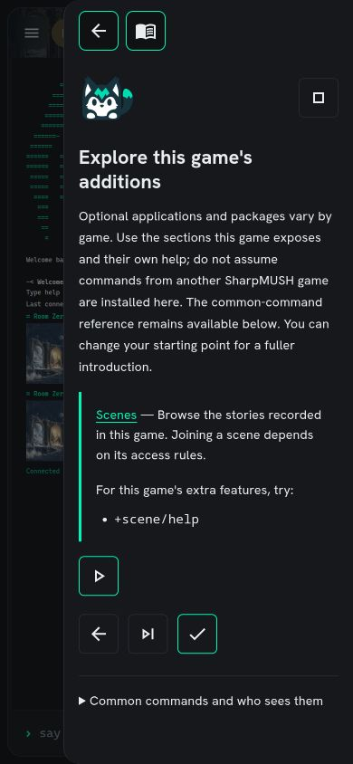
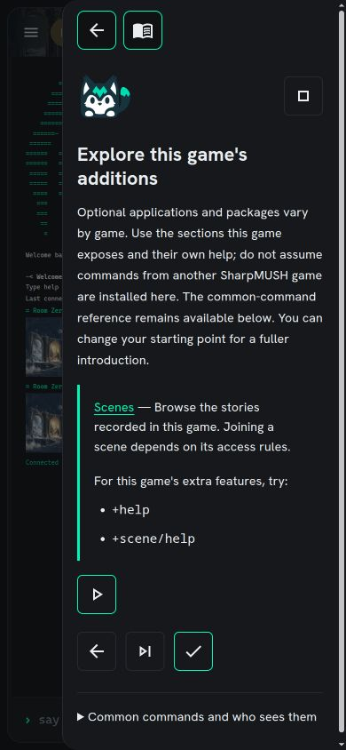
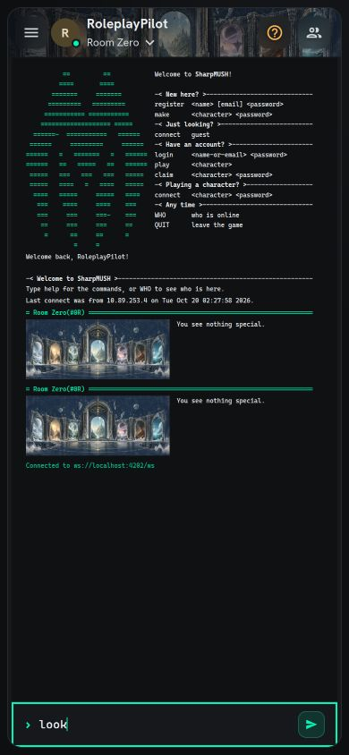
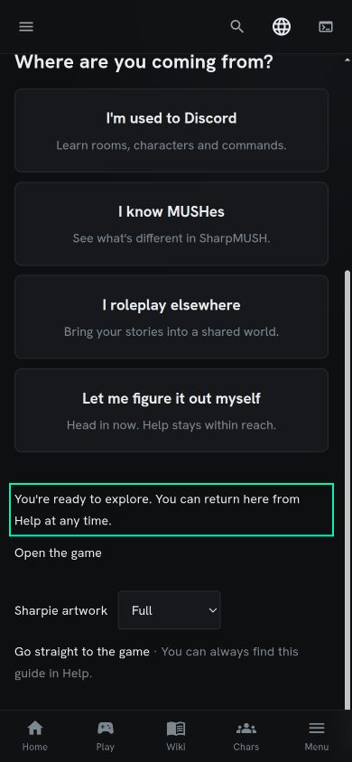
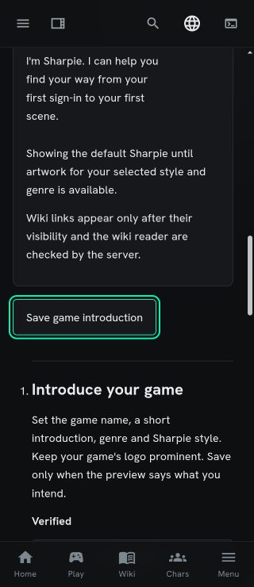
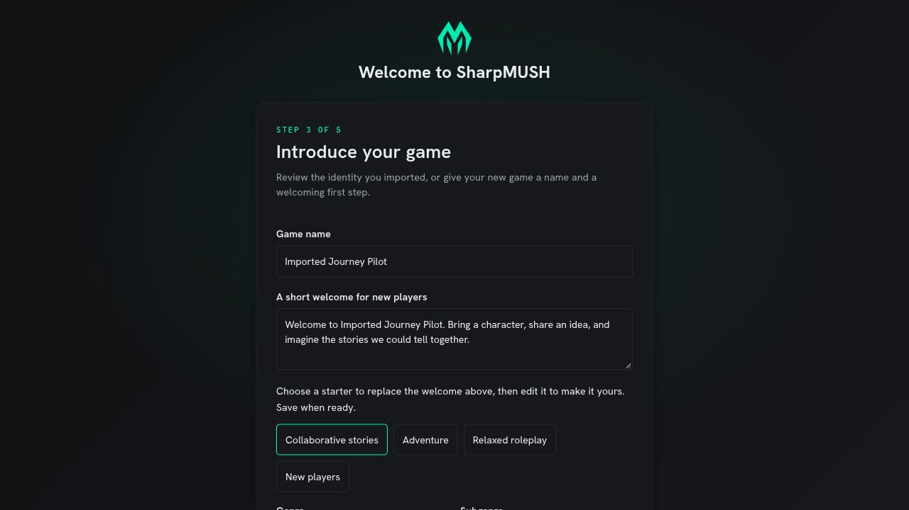
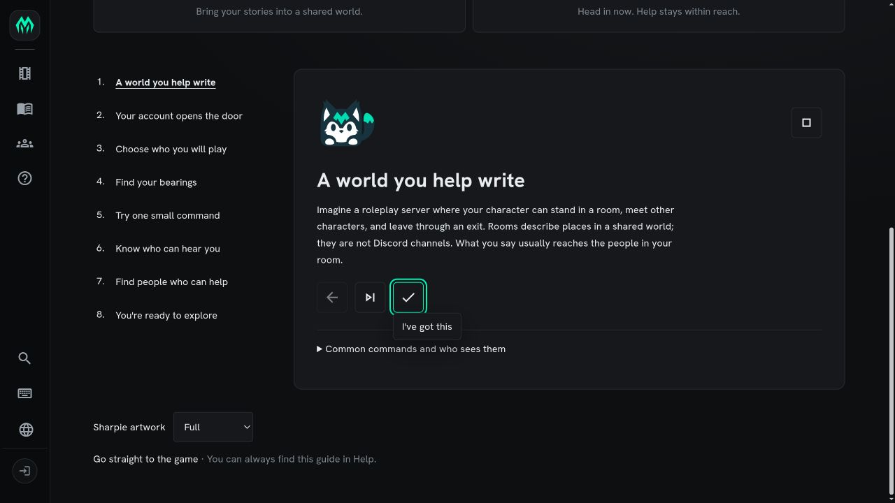
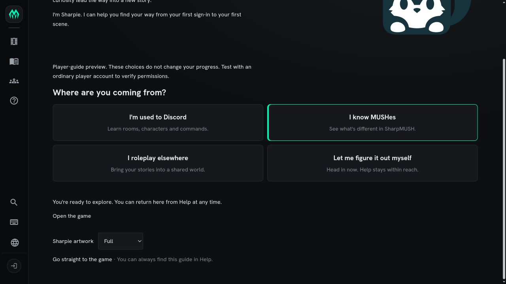

# Sharpie onboarding visual review

Actual isolated client screenshots captured on 2026-10-20. The local fixtures are
**Sharpie Journey Test** and **Imported Journey Pilot**; these are not production
pages or generated mockups.
Images are copied unchanged from browser captures. They show the approved
neutral mascot while genre candidates await quality and owner acceptance.

## Discord introduction and path selection

The welcome page shows the game identity, four familiarity choices and the first
lesson. Previously completed steps belong to the disposable browser test profile.
The remaining lesson controls continue below this viewport.

## Explicitly opened Play guide

The guide overlays play only after the player opens it. Its top icons return to
play or the full guide; the separate stop icon dismisses the journey. The player
is connected as the disposable RoleplayPilot character. Back, Skip and Complete
also use named icon controls. The visible Back tooltip demonstrates the focused
control's label.

## Narrow screens

At 390 CSS pixels the channel commands remain inset and readable. At 320 CSS
pixels the welcome introduction keeps the game name and mascot visible; the
choices are below this viewport. These are browser viewport simulations.

## Package help updates while the guide stays open

The final veteran lesson shows only verified package help. Temporarily disabling
the local Help Librarian's command matching removed `+help`; restoring its
original state brought it back. The guide remained open and focus stayed on the
lesson heading. These captures demonstrate command availability, not a package
uninstallation.

## Return to play without losing a draft

Activating Explore by keyboard closes the guide, focuses the composer and leaves
the unsent `look` draft intact. Nothing is sent automatically.

## Completion

Completing or skipping the final welcome lesson focuses the completion message.
Tab then reaches Open the game. Passive reload does not take focus.

## Administrator keyboard access at 320 pixels

Tab navigation reaches Save game introduction with a visible focus outline,
clear spacing, and the entire button above the bottom navigation. All 21 form
and checklist controls stayed within the 320px viewport. This check did not
change settings or checklist state.

## Editable welcome starters

First Setup and the administrator onboarding page share four optional welcome
starters. Choosing one fills the draft with the current game name; the
administrator can edit it before saving. This capture shows Collaborative
stories selected in the disposable **Imported Journey Pilot** world's First
Setup form. The preview and Save action continue below this viewport.

See [validation and remaining gates](../sharpie-onboarding-validation.md).
These screenshots establish appearance of these states, not complete acceptance
of all routes, accessibility, authentication or artwork.

## Keyboard icon guidance and preview completion

In Imported Journey Pilot, keyboard focus exposes the icon action's tooltip.
Escape dismisses the tooltip without activating the action or moving focus.
The measured dark-theme focus outline has 12.49:1 contrast with the panel.

The administrator preview now reaches the completion message after completing
or skipping every lesson, without saving player progress. The published veteran
preview was exercised through all five lessons; focus lands on the completion
message.

