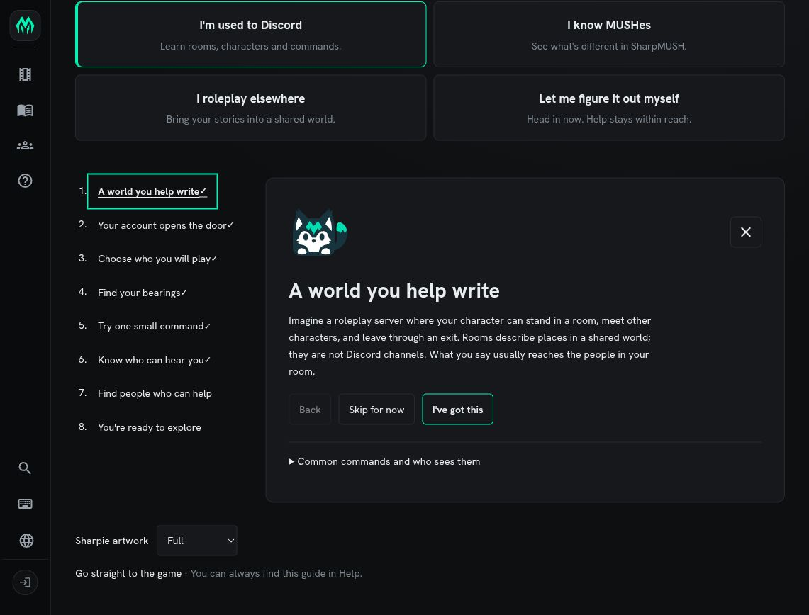
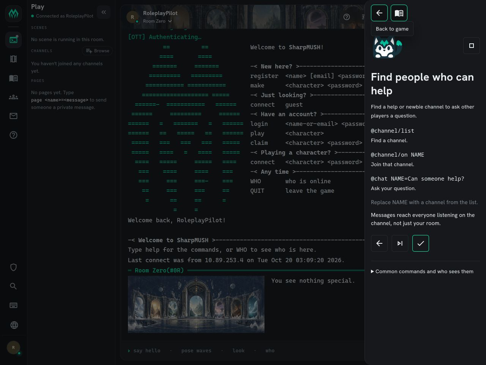
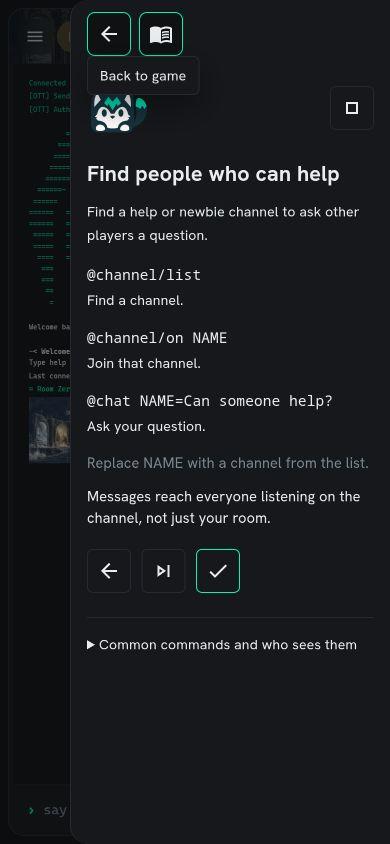
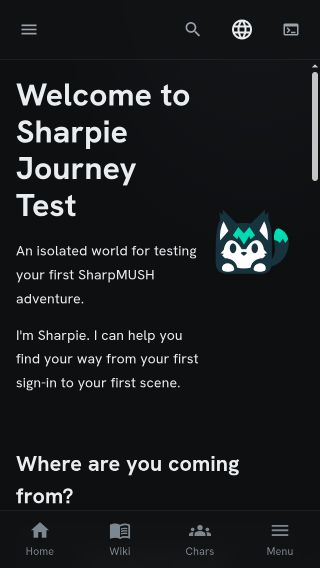
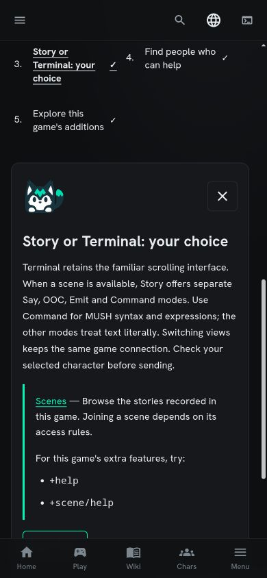

# Sharpie onboarding visual review

Actual isolated client screenshots captured on 2026-10-20. The local game is
**Sharpie Journey Test**; these are not production pages or generated mockups.
Images are copied unchanged from browser captures. They show the approved
neutral mascot while genre candidates await quality and owner acceptance.

## Discord introduction and path selection

The welcome page is scrolled to its choices and first lesson. Previously completed
steps belong to the disposable browser test profile.

## Explicitly opened Play guide

The guide overlays play only after the player opens it. Its top icons return to
play or the full guide; the separate stop icon dismisses the journey. This capture
is signed out, so the terminal is disconnected. Earlier connected-command evidence
is described in the validation record, not claimed by this image.

## Narrow screens

At 390 CSS pixels the channel commands remain inset and readable. At 320 CSS
pixels the welcome introduction keeps the game name and mascot visible; the
choices are below this viewport. These are browser viewport simulations.

## Experienced MUSH player on mobile

The authenticated veteran path explains the two Play modes and shows package
help verified for the active character. This 390px capture is scrolled to the
lesson; its remaining controls continue below the viewport.

See [validation and remaining gates](../sharpie-onboarding-validation.md).
These screenshots establish appearance of these states, not complete acceptance
of all routes, accessibility, authentication or artwork.
