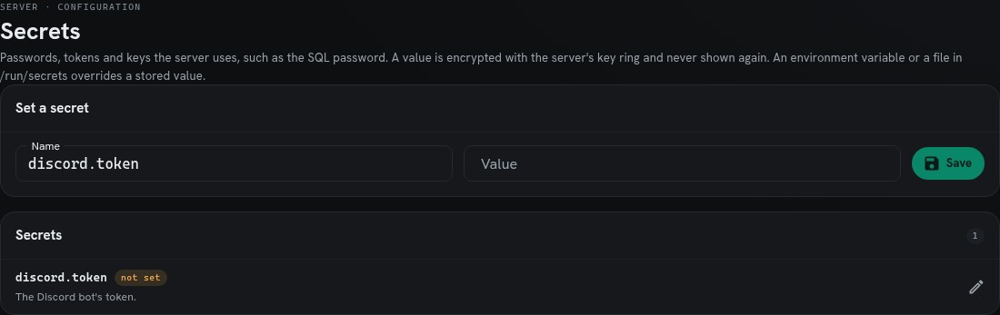
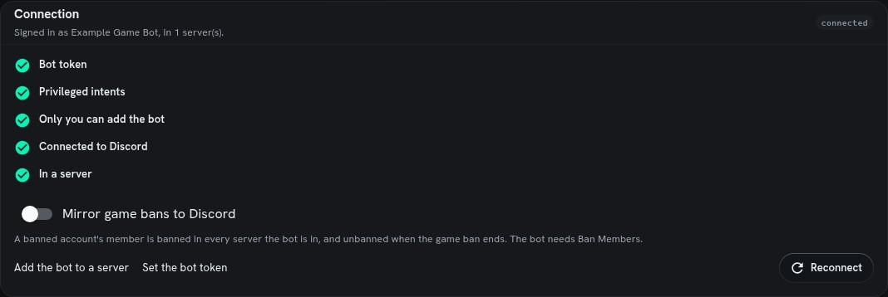
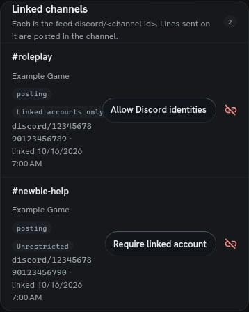

# Set up the Discord bridge

Connect one game's Discord bot to its server, then choose which channels exchange lines with game feeds. You need access to the Discord application and **Manage Server** in the target Discord server. In SharpMUSH, install the bundled `discord` package and give the operator its `discord.admin` permission. Wizard status alone does not supply a package-defined permission.

The screenshots below are genuine renders of the SharpMUSH portal with **representative synthetic configuration**. They contain no token and do not show a live Discord connection. Discord's own screens are described by name and linked to its maintained documentation.

## 1. Choose the application and bot

Open the [Discord Developer Portal](https://discord.com/developers/applications). Select the application intended for this game, or choose **New Application** and name it. Check its name on **General Information** before changing settings. Open **Bot** in that application's sidebar; current applications include a bot by default.

Use the bot's **token**, not its Application ID, Public Key or OAuth client secret. Obtain it on the Bot page; resetting it invalidates the previous token. Keep it private and enter it only into SharpMUSH's secret store in step 3. This bridge does not need a separate Node application, an Interactions Endpoint URL or a local tunnel.

Discord's [application creation instructions](https://docs.discord.com/developers/quick-start/getting-started#step-1-creating-an-app) explain the provider screens. Follow the application/bot setup portions; SharpMUSH already implements the bot.

## 2. Enable the gateway intents

On **Bot**, find **Privileged Gateway Intents**. Enable **Server Members Intent** and **Message Content Intent**, then save changes. SharpMUSH uses these to follow linked members and read incoming channel messages. Follow Discord's current [privileged intent requirements](https://docs.discord.com/developers/events/gateway#privileged-intents) if your application needs approval.

For a bot dedicated to your game, untick **Public Bot** so other people cannot add it to their own servers. This is the checklist's privacy recommendation; it does not by itself establish a connection.

## 3. Store the token and connect

In the game's portal, open **Build & manage > Discord** (`/admin/discord`), then **Set the bot token**. That opens **Configuration > Secrets** (`/admin/config/secrets`). Enter `discord.token` as the name, paste the bot token into the password field and save. The value is write-only; the page reports its source afterward, never the token itself. A file or environment override takes precedence over a stored value, so check the reported source if a replacement is not taking effect.



*Representative example: the actual Secrets component before a token is entered. The field is deliberately empty; no credential was generated or captured.*

Return to **Discord** and select **Reconnect**. After changing the token or privileged intents, reconnect again. In-game operators may instead use:

```sharp
@secret discord.token=<your bot token>
@discord/connect
@discord
```

Use a private administrator session for token entry; do not include a real token in screenshots, tickets or shared command transcripts.

The bot bridge's `discord.token` is separate from optional **Sign in with Discord** account authentication. You do not need to configure an OAuth sign-in provider to use the bridge. Conversely, signing in with Discord does not perform the bridge's member `/link` flow.

## 4. Invite it to the server

After Discord accepts the token, the portal displays **Add the bot to a server**. `@discord` also prints the invite URL. Use that generated link: it selects the correct application and requests both `bot` and `applications.commands` scopes with the permissions this implementation uses.

Choose your server in Discord's authorization screen and keep the requested permissions. The normal invite requests **View Channels**, **Send Messages**, **Send Messages in Threads**, **Read Message History**, **Manage Messages**, **Manage Webhooks**, **Manage Roles** and **Create Events**. **Ban Members** is additionally required if you enable game-ban mirroring. Administrator permission is unnecessary.

You need **Manage Server** to add the bot. If the server requires two-factor authentication for moderation, enable it on the application's owner account as well. In **Server Settings > Roles**, put the bot's role above the **Linked** role and any roles it must manage. Channel/category overrides must also allow the bot's work; a successful server invite does not override a channel denial.

## 5. Check that setup succeeded

Return to the game's Discord page. Its connection status should be **Connected**, the bot name should be correct, and the checklist should show the token, intents, private-bot recommendation, gateway and server steps complete. `@discord` reports the same setup state. If ban mirroring is enabled, check its additional Ban Members step too.



*Representative example: actual Admin > Discord components with a synthetic connected bot. This illustrates the expected state; it is not evidence that any real bot was connected during documentation work.*

| What you see | What to check |
|---|---|
| No token | Store `discord.token`; check whether an environment/file override wins. |
| Token refused | Obtain the correct bot token, store it and reconnect. A reset invalidates the old token. |
| Intents missing | Enable both intents on this application's Bot page, save and reconnect. |
| Connected, no server | Open this bot's generated invite and authorize the intended server. |
| Cannot reach Discord | Check the server's outbound connectivity and the displayed error, then reconnect. |
| Channel permission error | Check the bot's server role, role order and channel/category overrides; retry the operation after fixing them. |

## 6. Copy IDs and link a channel

In Discord, open **User Settings > Advanced > Developer Mode**. Right-click the channel and select **Copy Channel ID**. For a server, right-click its icon and select **Copy Server ID**; a name or invite code is not its numeric ID. Discord's [illustrated ID instructions](https://support.discord.com/hc/en-us/articles/206346498-Where-can-I-find-my-User-Server-Message-ID) cover desktop and mobile.

On the game's Discord page, select an available text channel and **Link channel**, or run this with your own copied channel ID:

```sharp
@discord/link 1234567890123456789
```

The example ID is a placeholder. Wait for the resulting notification: the command first acknowledges work, then reports Discord's answer. Linking creates a webhook and the game feed `discord/<channel id>`. The linked-channel row should show a healthy state and no permission error.

New links are **Restricted**: only members holding the bot-managed **Linked** role may send in Discord. For a public newbie/help channel, choose **Allow Discord identities** or use `@discord/unrestricted <channel id>`. Members without game accounts then speak under distinct Discord identities. They still follow Discord permissions and normal game feed permissions; external identities cannot satisfy object-based send locks. Disabled or banned linked accounts do not bypass those rules. **Require linked account** restores the linked-account requirement.



*Representative example: the real channel access controls at a 390-pixel viewport. Each mode applies to one channel.*

`@discord/unlink <channel id>` stops forwarding, removes the webhook and restores the posting-permission bits SharpMUSH changed where safe. The game feed/history remain. If cleanup is refused, the link remains visible with an error so you can fix permissions and retry. **Resume** is for a stopped existing link, not for creating a new one.

## 7. Link a member and choose a speaker

Set the game's public website address, `mud_url`, before inviting members to link. In the game's Discord server, a member types **`/link`**. The bot replies privately with a single-use link valid for ten minutes. Open it while signed in to the intended active game account and finish confirmation. The bot grants the **Linked** role. One game account links to one Discord account; unlinking and switching accounts has cooldown/ban restrictions described in `help @discord members`.

In the Discord channel, type **`/speakas <character>`** and enter the exact name or objid of a character owned by that linked game account. This choice applies only to that channel. The character must still pass the game feed's send permissions. The game alternative, run as that character, is `@discord/speak <channel id>`; `@discord/speak/off <channel id>` clears it.

Verify with an ordinary non-secret message in a channel you administer: it should appear once on the game's corresponding feed under the chosen character, and an ordinary game feed line should reach Discord. In a restricted channel, no chosen character means no incoming game speech. In an unrestricted channel, no chosen character uses the member's Discord identity instead. Received Discord text is never evaluated as game code.

For role synchronization, ban mirroring and scheduled events, see `help @discord roles`, `help @discord bans` and `help @discord events`. Those are optional after the basic bridge works.
